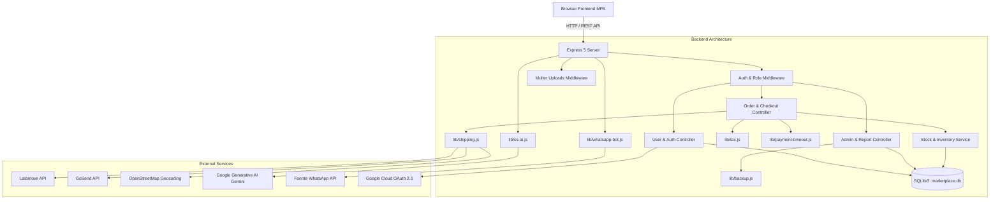

# Evaluasi Kesehatan Kode (Code Health & Refactoring Plan) — PasarKita / PT Sahabat Jaya Sukses

Dokumen ini menyajikan analisis arsitektur, beban teknis (*technical debt*), duplikasi kode, ketergantungan antar komponen (*coupling*), ketiadaan pengujian otomatis, serta panduan refactoring menyeluruh untuk [server.js](file:///d:/Projects/marketplace%20new/server.js) dan [public/admin.js](file:///d:/Projects/marketplace%20new/public/admin.js).

---

## 1. Metrik Kode & Beban Ukuran File

### A. Distribusi Baris Kode (Lines of Code)

| Komponen | File Utama | Jumlah Baris | Ukuran File | Status Evaluasi |
|---|---|---|---|---|
| **Backend Core** | [server.js](file:///d:/Projects/marketplace%20new/server.js) | **5.553 baris** | 199 KB | 🔴 Monolitik Ekstrem |
| **Admin Frontend** | [public/admin.js](file:///d:/Projects/marketplace%20new/public/admin.js) | **4.591 baris** | 190 KB | 🔴 Monolitik Ekstrem |
| **Frontend Utility** | [public/common.js](file:///d:/Projects/marketplace%20new/public/common.js) | 1.444 baris | 53 KB | 🟡 Terlalu Besar |
| **Modul Ongkir** | [lib/shipping.js](file:///d:/Projects/marketplace%20new/lib/shipping.js) | 1.015 baris | 32 KB | 🟡 Perlu Modularisasi Provider |
| **Keranjang & Checkout** | [public/cart.js](file:///d:/Projects/marketplace%20new/public/cart.js) | 714 baris | 26 KB | 🟢 Normal |
| **Invoice Frontend** | [public/invoice.js](file:///d:/Projects/marketplace%20new/public/invoice.js) | 519 baris | 23 KB | 🟢 Normal |
| **Halaman Layanan** | [public/layanan.js](file:///d:/Projects/marketplace%20new/public/layanan.js) | 411 baris | 18 KB | 🟢 Normal |
| **Library Pembantu (`lib/` sisanya)** | 8 file modul | 954 baris | ~28 KB | 🟢 Terstruktur Baik |

**Total Keseluruhan Kode**:
- Backend: ~7.500 baris JavaScript
- Frontend: ~10.600 baris JavaScript
- **Total: ~18.100 baris kode murni (tanpa dependencies)**.

---

## 2. Masalah Duplikasi Kode & Tight Coupling

### BIZ-DUPL-01: Duplikasi Fungsi Formatter & Sanitasi
1. **`formatRupiah()`**: Didefinisikan berulang-ulang secara independen di:
   - [lib/cs-ai.js:11](file:///d:/Projects/marketplace%20new/lib/cs-ai.js#L11)
   - [server.js:2762](file:///d:/Projects/marketplace%20new/server.js#L2762) (`formatIdr`)
   - [public/common.js](file:///d:/Projects/marketplace%20new/public/common.js)
   - [public/cart.js](file:///d:/Projects/marketplace%20new/public/cart.js)
   - [public/invoice.js](file:///d:/Projects/marketplace%20new/public/invoice.js)
   - [public/admin.js](file:///d:/Projects/marketplace%20new/public/admin.js)
2. **`escapeHtml()`**: Didefinisikan di `orders.js` dan `common.js`, tetapi **tidak dimuat / tidak digunakan** di `admin.js` dan `invoice.js`, sehingga menyebabkan celah XSS kritis (lihat temuan di `02-security.md`).
3. **Mapping Objek Order**: Logika normalisasi status dan field pesanan diulang di backend ([server.js:2714](file:///d:/Projects/marketplace%20new/server.js#L2714) `mapOrderRow`) dan di frontend ([public/orders.js](file:///d:/Projects/marketplace%20new/public/orders.js), [public/invoice.js](file:///d:/Projects/marketplace%20new/public/invoice.js), dan [public/admin.js](file:///d:/Projects/marketplace%20new/public/admin.js)).

### BIZ-COUP-02: Keterikatan Arsitektur yang Erat (*Tight Coupling*)
* [server.js](file:///d:/Projects/marketplace%20new/server.js) menampung:
  1. Definisi koneksi SQLite3 dan migrasi DDL 22 tabel database ([server.js:911-1349](file:///d:/Projects/marketplace%20new/server.js#L911-L1349)).
  2. Data awal / seeding katalog produk default ([server.js:1391-1435](file:///d:/Projects/marketplace%20new/server.js#L1391-L1435)).
  3. Konfigurasi 8 instance Multer disk/memory storage ([server.js:360-570](file:///d:/Projects/marketplace%20new/server.js#L360-L570)).
  4. Background job interval pembersihan pesanan expired ([server.js:5536](file:///d:/Projects/marketplace%20new/server.js#L5536)).
  5. 103 rute controller dan query raw SQL yang ditulis langsung (*inline*).

---

## 3. Area Tanpa Pengujian Otomatis (*Zero Test Coverage*)

Aplikasi saat ini memiliki **0% Test Coverage**:
- Tidak ditemukan direktori `tests/`, `test/`, atau file `*.test.js` / `*.spec.js`.
- Tidak ada test runner yang dikonfigurasi di [package.json](file:///d:/Projects/marketplace%20new/package.json) (hanya ada `"scripts": { "start": "node server.js", "dev": "node server.js" }`).

### Jalur Kritis yang Sangat Berisiko Tanpa Test Otomatis:
1. **Alur Checkout & Validasi Stok**: Perhitungan varian ukuran dan pemotongan stok pool multi-gudang (SJS vs SJL).
2. **Kalkulasi Pajak & Ongkir**: Rumus exclude/include PPN dan batas bebas biaya minimum.
3. **Transisi Status Order & Rollback**: Pembatalan pesanan akibat timeout dan pengembalian stok ke `inventory_ledger`.
4. **Otentikasi Role**: Pembatasan wewenang admin vs manager (misal: manager hanya boleh membuat user biasa).

---

## 4. File Sisa & Artefak Sampah di Repositori

Ditemukan beberapa file sisa debugging, ekstraksi log lama, dan dokumen biner besar di root repositori yang tidak relevan dengan runtime aplikasi:

| Nama File | Ukuran | Keterangan & Asal Usul | Rekomendasi |
|---|---|---|---|
| [extract.txt](file:///d:/Projects/marketplace%20new/extract.txt) | 1,6 KB | Sisa teks log regex dari sesi sebelumnya | Hapus |
| [extract2.txt](file:///d:/Projects/marketplace%20new/extract2.txt) | 21,8 KB | Sisa dump log JSON pencarian event listener | Hapus |
| [script.py](file:///d:/Projects/marketplace%20new/script.py) | 529 B | Script Python sementara untuk scraping transcript | Hapus |
| [restore.patch](file:///d:/Projects/marketplace%20new/restore.patch) | 4,1 KB | File patch git sementara bekas pemulihan kode `admin.js` | Hapus |
| [PT Sahabat Jaya Sukses.pdf](file:///d:/Projects/marketplace%20new/PT%20Sahabat%20Jaya%20Sukses.pdf) | **13,9 MB** | File PDF biner besar di root git | Pindahkan ke arsip / abaikan di `.gitignore` |
| [PT Sahabat Jaya Sukses.html](file:///d:/Projects/marketplace%20new/PT%20Sahabat%20Jaya%20Sukses.html) | 10,8 KB | File export HTML statis lama di root | Hapus / Pindahkan |
| `PT Sahabat Jaya Sukses_files/` | 1,7 MB | Folder aset pendukung export HTML lama | Hapus / Pindahkan |

---

## 5. Rencana Arsitektur & Pemecahan `server.js` (Modularisasi)

Untuk mengurangi kompleksitas 5.553 baris kode, disarankan membagi backend menjadi struktur standar berbasis MVC / Layered Architecture:

```text
src/
├── config/
│   ├── database.js          # Inisialisasi SQLite3, PRAGMA WAL & busy_timeout
│   ├── environment.js       # Validasi variabel .env (wajibkan JWT_SECRET)
│   └── constants.js         # Konstanta default profil & setting
├── database/
│   ├── migrations.js        # DDL pembuatan tabel SQLite (CREATE TABLE IF NOT EXISTS)
│   └── seeds.js             # Data awal admin dan produk awal
├── middlewares/
│   ├── auth.middleware.js   # authMiddleware, optionalAuth, requireRole
│   ├── upload.middleware.js # Definisi instance Multer tersentralisasi
│   └── rate-limit.js        # Proteksi login, register, dan tracking
├── routes/
│   ├── auth.routes.js       # /api/auth/*
│   ├── users.routes.js      # /api/users/*
│   ├── products.routes.js   # /api/products/* & /api/categories/*
│   ├── orders.routes.js     # /api/orders/* & /api/checkout
│   ├── admin.routes.js      # /api/admin/* (laporan, settings, brands)
│   ├── layanan.routes.js    # /api/layanan/*
│   └── webhook.routes.js    # /api/whatsapp/webhook
├── controllers/             # Handler logika request-response HTTP
│   ├── auth.controller.js
│   ├── checkout.controller.js
│   └── orders.controller.js
├── services/                # Logika bisnis inti
│   ├── stock.service.js     # applyStockDeduction, applyStockRestore
│   ├── point.service.js     # awardPoints, redeemReward
│   └── payment-timeout.job.js # cron/interval expireUnpaidOrders
└── app.js                   # Entry point Express bersih (<100 baris)
```

---

## 6. Rencana Pemecahan `public/admin.js`

File `public/admin.js` (4.591 baris) memuat seluruh logika DOM untuk 13 tab dashboard admin.
Direkomendasikan dipecah menjadi modul-modul ES6 (`type="module"` atau script terpisah di HTML):

```text
public/admin/
├── js/
│   ├── admin-core.js        # Inisialisasi tab switching & otentikasi admin
│   ├── admin-orders.js      # Tabel pesanan, ubah status, bukti bayar, ekspedisi
│   ├── admin-products.js    # CRUD produk, varian ukuran, dan gambar
│   ├── admin-users.js       # Setting user & manajemen role
│   ├── admin-layanan.js     # Tiket layanan custom & download lampiran
│   ├── admin-reports.js     # Laporan penjualan, laporan stok, analitik pengunjung
│   └── admin-settings.js    # Jasa kirim, bank, profil perusahaan, pajak
```

---

## 7. Peta Dependensi Antar Bagian (Dependency Graph)



---

## 8. Daftar File / Bagian yang BELUM Dibaca

1. File biner [PT Sahabat Jaya Sukses.pdf](file:///d:/Projects/marketplace%20new/PT%20Sahabat%20Jaya%20Sukses.pdf) (13,9 MB).
2. Library pihak ketiga di CDN luar (`Google GSI` dan `html2pdf`).
